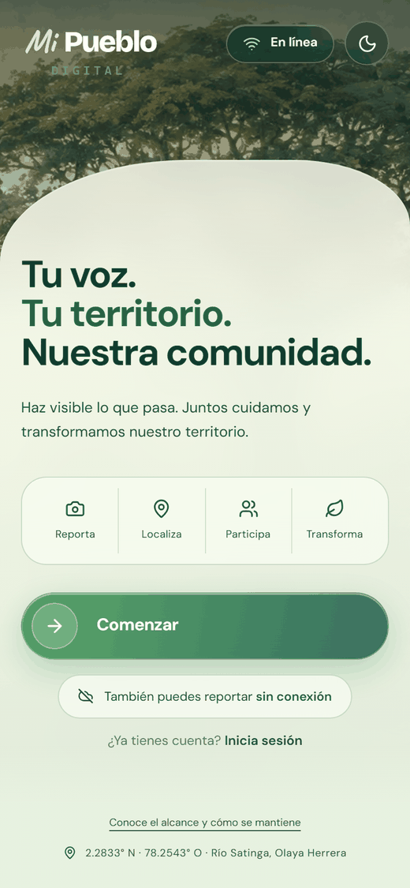
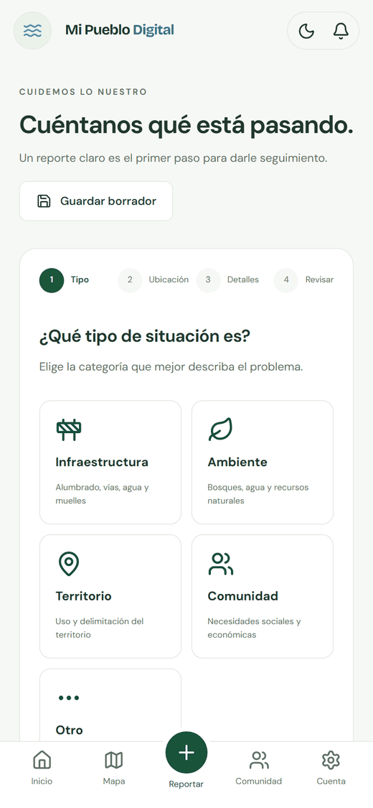
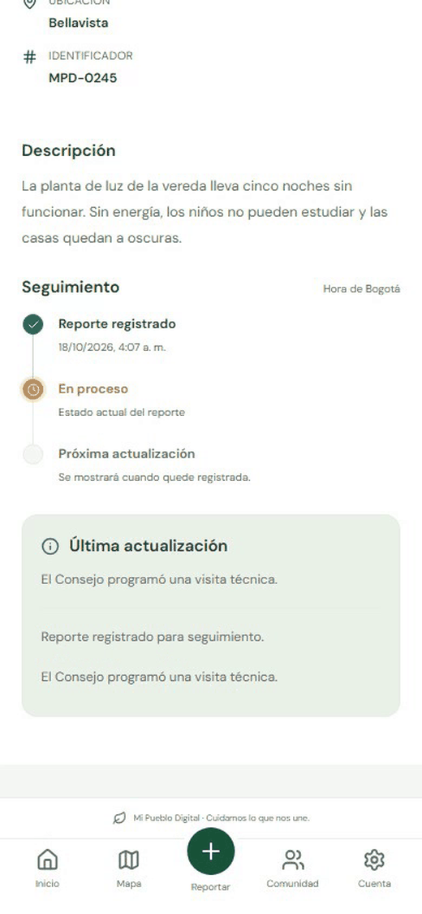
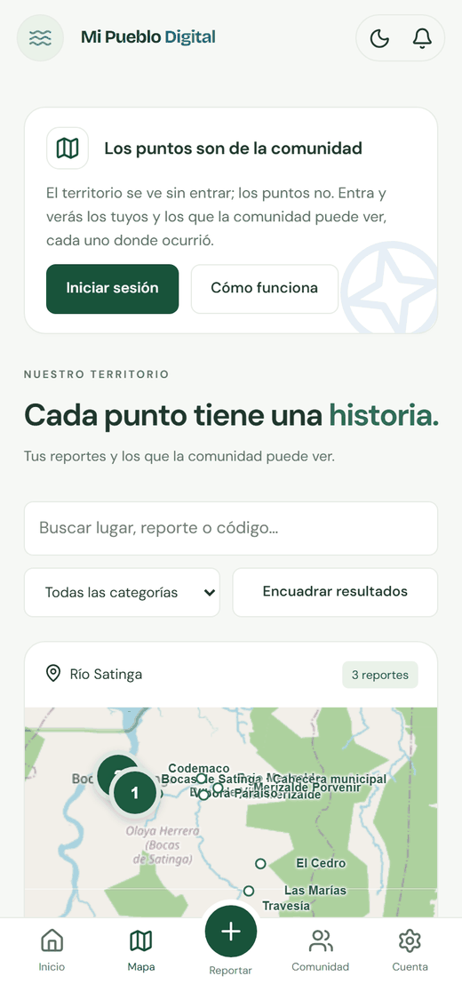
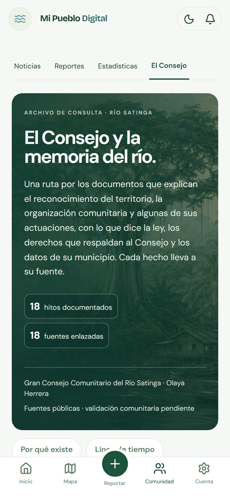
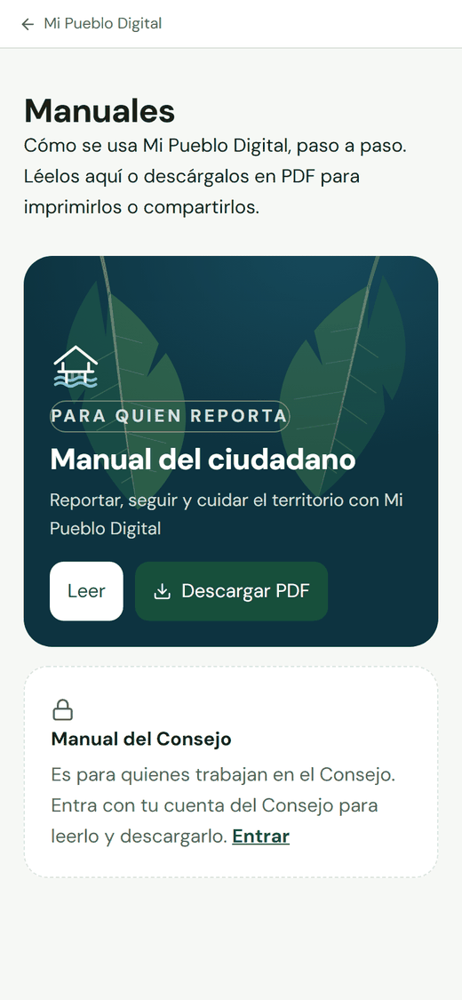
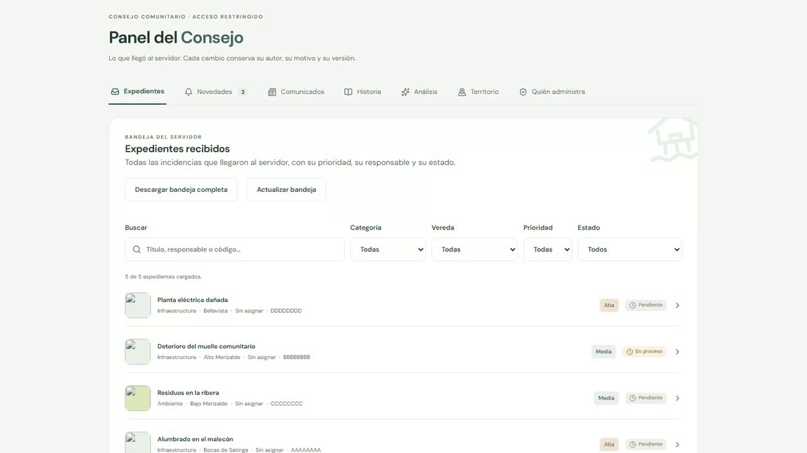

# Mi Pueblo Digital

Aplicación de gestión de incidencias del **Gran Consejo Comunitario Río
Satinga**, Olaya Herrera, Nariño. La comunidad reporta lo que pasa en el
territorio; el Consejo lo recibe, lo gestiona y responde.

[](https://github.com/JFrangel/mipueblodigital/raw/develop/docs/video/mi-pueblo-digital-demo.mp4)

▶ **[Ver el video completo](https://github.com/JFrangel/mipueblodigital/raw/develop/docs/video/mi-pueblo-digital-demo.mp4)**
(4 min 28 s, con voz): cómo un reporte sale de la vereda, llega al Consejo, se
gestiona, se publica como resumen y vuelve a quien lo envió. El avance de arriba
son seis momentos del video. El archivo está en
[`docs/video/`](docs/video); el visor de GitHub no
reproduce archivos tan grandes, por eso el enlace abre el video directo.

## Cómo se ve

| Bienvenida | Reportar | Detalle de un reporte | Mapa |
| :---: | :---: | :---: | :---: |
|  |  |  |  |

| Memoria del Consejo | Manuales | Panel del Consejo |
| :---: | :---: | :---: |
|  |  |  |

Capturas de la aplicación real con **datos de ejemplo**: el producto no lleva
reportes inventados. El detalle de un expediente en el panel del Consejo está en
[`docs/imagenes/08-panel-expediente.png`](docs/imagenes/08-panel-expediente.png).

## Manuales en PDF

| Manual | Para quién | PDF |
| --- | --- | --- |
| Del ciudadano | Quien reporta (formato A5, pensado para el teléfono) | [`manual-ciudadano.pdf`](public/manuales/manual-ciudadano.pdf) · [en Markdown](docs/manual-ciudadano.md) |
| Operativo del Consejo | Quien gestiona (A4, con tablas) | [`manual-consejo.pdf`](public/manuales/manual-consejo.pdf) · [en Markdown](docs/manual-consejo.md) |

Los dos PDF, el Markdown y la vista de la aplicación salen **del mismo texto**
([cómo se mantienen](docs/manuales.md)). Dentro de la aplicación están en
**Herramientas → Manuales**; el del Consejo solo se muestra con una cuenta del
Consejo, pero el archivo del repositorio no contiene datos internos.

## Qué hace hoy

- **Reportar** con fotografía, vereda y punto en el mapa, con sesión real de
  Firebase. Sin señal, el reporte queda en cola y sale solo cuando vuelve la red.
- **Borrador automático** por cuenta al escribir y volver a editar después. En Android 2.2, la cola nativa reintenta con red aunque la actividad esté cerrada, con avisos del sistema; el navegador requiere una página viva.
- **Seguir el propio reporte** desde cualquier teléfono: el historial es de la
  cuenta, no del aparato.
- **Bandeja del Consejo** con estado, prioridad, responsable, control de versión
  optimista y auditoría de cada actuación. Se pagina completa (más de 500
  expedientes sin perder ni duplicar), se exporta entera a CSV y el Consejo ve
  el nombre con el que se registró quien reportó; la comunidad, nunca.
- **Visitas técnicas y notas con imagen** en cada expediente, y **hasta cinco
  fotografías** por reporte.
- **Catálogo de veredas** administrado por el Consejo: crear, renombrar, retirar
  sin borrar y validar una versión; la captura y el mapa usan el catálogo vigente.
- **Publicación comunitaria revisada**: solo un resumen aprobado por el Consejo
  puede aparecer, 24 horas después de su aprobación. El relato original queda privado.
- **Retirada de un expediente con su motivo**, que le llega a quien reportó, y
  **reapertura de un resumen publicado** sin volver a mostrar el relato.
- **Memoria del Consejo**: línea de tiempo de hitos con fecha, período y fuentes
  enlazadas, que el propio Consejo puede ampliar desde su panel.
- **Manuales de uso** del ciudadano y del Consejo, dentro de la aplicación y en PDF.
- **Informe de estadísticas** para la asamblea, que se imprime con portada y
  cierre del Consejo y también se abre desde el APK.
- **Comunicados** con portada, imágenes y anclado.
- **Mapa, estadísticas y calendario** sobre los reportes reales del territorio.
- **Avisos que llegan al teléfono** con la aplicación cerrada, en el APK y en el
  navegador. Se piden al enviar el primer reporte, no al abrir.
- **Dictar el relato por voz**: la API del navegador en el navegador, el
  reconocedor de Android dentro del APK. Ningún audio se guarda.
- **«Usar mi ubicación»** en el reporte, y con ella las **veredas que el catálogo
  no sitúa**: quien está allí pone el punto, y cuando varios coinciden el Consejo
  lo acepta y la vereda entra al mapa con su nombre.
- **Tres ayudas de redacción** con un modelo de lenguaje, solo con modelos
  gratuitos y sin que salga del territorio más de lo que cada una necesita.
- **Eliminación de cuenta**: se borran fotografías, ubicación y notas, los
  reportes pasan a ser anónimos (el Consejo conserva categoría, vereda, estado y
  fechas para las cifras), el trabajo interrumpido se retoma, y el Consejo puede
  **restablecer** la cuenta si quien la cerró cambia de idea.
- **Fluidez en el teléfono**: en pantallas de 800 px o menos las hojas decorativas
  no se animan y el telón de arranque no se dibuja; en escritorio siguen.

La aplicación **no lleva datos inventados**: lo que se ve es lo que la comunidad
reportó. Una instalación nueva arranca vacía, y cada pantalla dice de dónde sale
lo que enseña.

## Ejecutar

Requiere Node.js 24 y npm.

```bash
npm ci
npm run dev
```

Abrir http://127.0.0.1:3000. Copiar `.env.example` como `.env` y rellenarlo: sin
credenciales de Firebase no hay sesión, y sin las de Supabase no se guardan
fotografías.

## Verificar

```bash
npm run lint && npm run typecheck && npm test && npm run test:e2e
```

`test:e2e` compila antes de correr el navegador, porque **Playwright prueba
contra `.next`**: ejecutarlo sin compilar verifica la compilación anterior. La
primera vez hace falta `npx playwright install chromium`. Ejecutar `build` y
`dev` a la vez compite por `.next`.

El inventario verificable, resultados y límites se mantienen en
[pruebas y rendimiento](docs/pruebas-y-rendimiento.md) y en el
[catálogo de cada prueba](docs/catalogo-pruebas.md). La
[guía por archivo](docs/guia-pruebas-por-archivo.md) explica la intención de cada suite.

## Desplegar

Servidor Next.js, no exportación estática: las rutas protegidas y los detalles
dinámicos lo necesitan. `npm run build` y `npm start`.

El rol del Consejo se verifica en servidor mediante la reivindicación del token
o el campo `role: "admin"` de `accounts/{uid}`, que las reglas impiden modificar
desde clientes. Se concede mediante `node scripts/conceder-admin.mjs
correo@ejemplo.com` o desde el Panel del Consejo. Véase
[seguridad y privacidad](docs/seguridad-y-privacidad.md).

## Documentación

| Documento                                                                 | Para quién                                       |
| ------------------------------------------------------------------------- | ------------------------------------------------ |
| [Arquitectura](docs/arquitectura.md)                                      | Quien va a tocar el código o sostenerlo          |
| [Integraciones externas](docs/integraciones.md)                           | Quien sostenga la aplicación o responda por ella |
| [Empaquetado Android](docs/empaquetado-android.md)                        | Quien compile y publique la aplicación           |
| [Auditoría del modo sin conexión](docs/auditoria-offline-2026-09-16.md)   | Quien dude de qué funciona sin señal             |
| [Manual del ciudadano](docs/manual-ciudadano.md)                          | Quien reporta                                    |
| [Manual operativo del Consejo](docs/manual-consejo.md)                    | Quien gestiona                                   |
| [Manuales de uso: texto único, vista y PDF](docs/manuales.md)             | Quien mantenga los manuales                      |
| [Plan de salida a producción](docs/plan-produccion-2026-09-14.md)         | Quien coordina el piloto                         |
| [Especificación de producto](docs/specs/producto.md)                      | Sustentación                                     |
| [21 historias y criterios originales](docs/specs/criterios-originales.md) | Sustentación                                     |
| [Límites de operación y defensa](docs/specs/limites-operacion-defensa.md) | Sustentación                                     |
| [Conexiones y credenciales](docs/conexiones-2026-09-08.md)                | Quien opera el servidor                          |
| [Banco de consulta: finalidad y mantenimiento](docs/banco-consulta-consejo.md) | Consejo y mantenimiento técnico |
| [Auditoría y entrega Android 2.2](docs/auditoria-entrega-2026-10-02.md) | Quien valida, actualiza y opera la app |
| [Memoria documentada del Consejo](docs/investigacion-consejo-rio-satinga.md) | Consejo, comunidad e investigadores             |
| [Pruebas y rendimiento](docs/pruebas-y-rendimiento.md)                    | Quien valida y opera la app                      |
| [Mejoras del Consejo: verificación](docs/verificacion-mejoras-consejo-2026-10-21.md) | Quien revise el catálogo de veredas, la bandeja y las visitas |
| [Consistencia de reportes: corrección y registro](docs/correccion-consistencia-reportes-2026-10-21.md) | Quien revise listas, historial y eliminación de cuentas |
| [Catálogo de pruebas](docs/catalogo-pruebas.md)                           | Quien revisa cada caso automatizado              |
| [Guía de pruebas por archivo](docs/guia-pruebas-por-archivo.md)           | Quien necesita entender el alcance de cada suite |
| [Seguridad y privacidad](docs/seguridad-y-privacidad.md)                  | Consejo, operador y responsable de datos         |

La guía `/documentacion/`, dentro de la aplicación, explica entradas, procesos,
salidas y variantes en el lenguaje del territorio.

## Antes de abrirla a la comunidad

Lo que falta no es código. Está detallado en
[Límites conocidos](docs/arquitectura.md#14-límites-conocidos); en resumen:

1. **Rotar la clave de la cuenta de servicio de Firebase.** Estuvo dentro de
   despliegues que ya se borraron.
2. Validar el catálogo territorial con el Consejo. Seis de las dieciocho veredas
   no tienen punto documentado; sus reportes se gestionan igual, pero no se
   dibujan hasta que la comunidad las sitúe y el Consejo lo acepte.
3. Probar las reglas de Firestore en emulador contra una cuenta ajena y otra
   desactivada.
4. Verificar la restauración de copias de seguridad.
5. Completar las pruebas de accesibilidad.
6. **Firmar el APK para publicar**, y confirmar con el Consejo el identificador
   permanente `co.riosatinga.mipueblodigital`: no se puede cambiar después de
   la primera subida a Google Play.
7. Ejecutar el piloto comunitario y designar formalmente a la persona
   mantenedora.

Una compilación correcta no es la validación de las 21 historias de usuario.
